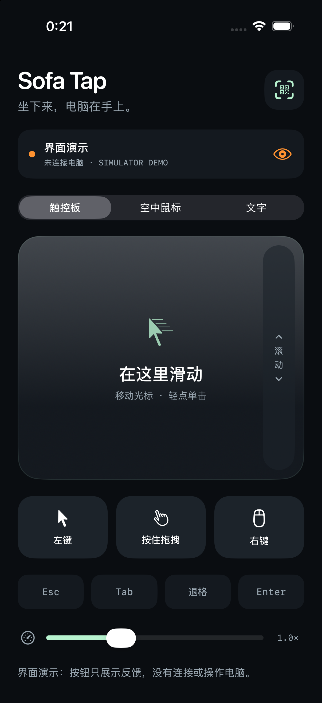

# Sofa Tap

**Your iPhone, your living-room remote.** Sofa Tap is an open-source couch remote by [chekusu](https://github.com/chekusu): a native iPhone touchpad, hold-to-move air mouse and explicit text sender for Windows and Mac. It uses local-network TLS, QR pairing and certificate pinning. **Alpha:** [0.3.0 Mac packages are notarized](https://github.com/chekusu/sofatap/releases/tag/v0.3.0-alpha); real iPhone-to-Mac pairing, text and selected pointer/key actions have [passed a scoped check](docs/verification/macos-0.3.0.md). Voice, physical air-mouse behavior and other platform acceptance remain pending. Bluetooth and a hosted service are not implemented.

[Source](https://github.com/chekusu/sofatap) · [Issues](https://github.com/chekusu/sofatap/issues) · [Releases](https://github.com/chekusu/sofatap/releases) · [MIT license](LICENSE)



*Simulator demo; the screenshot does not establish physical-device behavior.*

## 用 iPhone 操作客厅里的电脑

Sofa Tap 把 iPhone 变成 Windows 或 Mac 的触控板、空中鼠标和文字输入器。电视显示电脑画面，手机控制电脑的系统鼠标；在手机原生文本框里用 Typeless、系统听写或其他键盘生成文字，检查后点发送，输入到电脑当前聚焦的位置。

当前是 **alpha 预览版**。2026-10-11 已在真实 iPhone 与最终公证的 Apple Silicon Mac 接收端完成相机扫码、TLS 连接、文字精确读回、部分按键和指针操作；[验收记录](docs/verification/macos-0.3.0.md) 列出了具体边界。Typeless、实际语音、实体陀螺仪、拖拽与滚动，以及本版 Windows 原生窗口和 Linux GUI 仍待实测。项目没有已上线的独立域名或云服务；命名与域名查询见 [名称说明](docs/NAME.md)。

## 已实现

- 原生 SwiftUI iPhone App，最低 iOS 17；标准 `UITextView` 保留第三方键盘、中文输入组合和听写流程。
- 触控板、左右点击、按住拖动、滚动，以及按住按钮转动手机的空中鼠标。
- Windows 接收端通过 Win32 `SendInput` 注入鼠标、按键和完整 Unicode 文本，不自动追加回车。
- Mac 接收端通过 Quartz 提交鼠标、拖拽、滚轮、快捷键和 Unicode 文字；在本机明确授予辅助功能权限后使用。手机“全选”自动切换为 Command+A。
- 局域网 WSS/TLS、二维码配对、证书指纹校验；iPhone Keychain 和 Windows DPAPI 保存配对凭据；Mac 接收端使用仅当前用户可读的凭据文件。
- 电脑端配对使用原生窗口：Mac AppKit/SwiftUI、Windows WinForms；Linux 提供 GTK3 演练窗口。二维码通过本机私有管道传递，接收端不提供网页配对界面。
- 前后台切换保护、发送确认、草稿保留、断线禁止自动重放。
- Windows x64 自包含可执行文件；Mac 提供 Apple Silicon 和 Intel 两份原生 `.app` 构建，均不需要另外安装 .NET。

第一版通过家庭局域网连接。蓝牙连接尚未实现。手机与电脑需要网络互通；客人 Wi-Fi 的设备隔离可能阻止连接。

## 平台进度

| 平台 | 当前状态 |
| --- | --- |
| iPhone | iOS 17+；iPhone 17 Pro Max 上的 0.3.0 (4) 已通过部分 Mac 联合验收，语音与陀螺仪待测 |
| Windows | 0.3.0 原生接收端已发布；本版 UI 和手机联合实测待完成 |
| Mac | macOS 15+；arm64 / x64 均已公证，Apple Silicon 完成部分真机验收，Intel 实机输入待测 |
| Linux | GTK3 原生配对窗口仅供 `--dry-run` 验证；桌面输入后端是后续计划，不能控制桌面 |

Windows 和 Mac 共用配对、TLS 与输入协议，各自的系统输入后端实现 `IInputInjector`。Linux 后续将按 X11 / Wayland 的授权方式分别实现后端；目前没有把 Linux 模拟器或协议通过宣称为桌面支持。

## 开始使用

当前发布版本为 **[v0.3.0-alpha](https://github.com/chekusu/sofatap/releases/tag/v0.3.0-alpha)**。Windows 预览包名称是 `SofaTap-Windows-x64.zip`，对应校验文件为 `SofaTap-Windows-x64.zip.sha256`。解压并运行 `SofaTap.exe` 会显示 WinForms 原生配对窗口；历史版本 `v0.1.1-alpha` 使用浏览器。防火墙只允许接收端通过家庭的专用网络。

Mac 从同一发布页下载 `SofaTap-macOS-arm64-notarized.zip` 或 `SofaTap-macOS-x64-notarized.zip` 及对应 `.sha256`。两份包均通过 Apple 公证；安装与授权步骤见 [Mac 启动说明](docs/MAC-START.md)，固定源码版本、SHA256 和实机范围见 [0.3.0 验收记录](docs/verification/macos-0.3.0.md)。

在 Xcode 中打开 `ios/SofaTap.xcodeproj`，选择自己的开发团队和连接的 iPhone，运行 App。真机安装需要有效开发签名、设备配对和手机上的开发者模式。仓库不包含开发账号、签名证书或 provisioning profile。

手机扫描电脑原生窗口里的二维码，或粘贴完整配对链接。连上后，在电视上找到目标输入框并点选，在手机文字页完成输入，再明确点发送。Typeless 的实际兼容性需要在真机上验证。

详细步骤见 [Windows 启动说明](docs/WINDOWS-START.md)、[Mac 启动说明](docs/MAC-START.md)、[iOS 构建说明](ios/README.md) 和 [实机验收清单](docs/ACCEPTANCE.md)。配对链接含有控制凭据，应保留在自己的设备上。

## 从旧名称版本升级

`v0.1.1-alpha` 使用新的 `sofatap://` 配对链接、`com.chekusu.sofatap` iPhone bundle ID 和 `%LOCALAPPDATA%\SofaTap` Windows 配对目录。旧配对和手机草稿不会自动迁移；如需保留旧草稿，请先手动复制，再用新版本重新扫码配对。

如果已经安装过旧版本，先关闭旧接收端，在旧安装目录运行其 `Disable-Autostart.ps1`，或在 `shell:startup` 中删除旧的 `Tiltro.lnk` 快捷方式，再启动 `SofaTap.exe`。否则旧接收端可能占用端口。完整步骤见 [Windows 启动说明](docs/WINDOWS-START.md#从旧名称版本升级)。

## 从源码构建

接收端需要 .NET 10 SDK。在 Mac/Unix 上构建包含许可文本的 Windows ZIP：

```sh
bash scripts/build-windows.sh
```

如 SDK 在自定义位置，可将 `SOFATAP_DOTNET` 设为 `dotnet` 可执行文件路径。脚本还需要 Python 3，结果写入 `artifacts/SofaTap-Windows-x64.zip`。它按实际解析的 NuGet 版本保留 .NET、ASP.NET Core 和运行依赖的许可。

Windows 开发者可以在 PowerShell 中构建底层接收组件（普通用户应使用包含原生窗口的完整包）：

```powershell
dotnet publish host/SofaTap.Host.csproj -c Release -r win-x64 --self-contained true -p:PublishSingleFile=true -p:IncludeNativeLibrariesForSelfExtract=true
```

分发自包含程序时也应附上 `LICENSE`、`THIRD-PARTY-NOTICES.md` 和相应第三方许可；完整打包流程见构建脚本。

在 macOS 上构建 Mac 接收端：

```sh
bash scripts/build-macos.sh arm64
bash scripts/build-macos.sh x64
```

输出为 `artifacts/SofaTap-macOS-arm64.zip` 与 `artifacts/SofaTap-macOS-x64.zip`，包含应用、许可和 SHA256。默认使用 ad-hoc 开发签名；CHEKUSU Developer ID 分发签名和 Apple 公证流程见 [公证说明](docs/NOTARIZATION.md)。

iPhone 用 Xcode 打开现成工程即可。`ios/project.yml` 是 XcodeGen 工程源；修改它后运行 `xcodegen generate --spec ios/project.yml`。备用直接编译方式见 [iOS 说明](ios/README.md)，设备编译成功不等于完成签名安装。

## 开发验证

Mac 上安装 .NET 10 SDK、Python 3 后：

```sh
python3 -m pip install websockets==16.0
dotnet run --project tests/host/SofaTap.Host.Tests.csproj -c Release
SOFATAP_DOTNET="$(command -v dotnet)" python3 tests/smoke.py
swiftc ios/SofaTap/Core/Pairing.swift tests/PairingTests.swift -o /tmp/sofatap-pairing-tests
/tmp/sofatap-pairing-tests
swiftc ios/SofaTap/Core/ReceiverState.swift tests/ReceiverStateTests.swift -o /tmp/sofatap-receiver-tests
/tmp/sofatap-receiver-tests
bash ios/scripts/build-manual.sh device
```

Host runner 使用模拟输入器。TLS/WebSocket 测试启动临时接收端并明确使用 `--dry-run`，不会向系统注入输入。最后一项编译并链接未配置签名的 ARM64 iOS App，不安装到手机。CI 执行相同层级的检查。

编译、模拟器界面和协议测试分别只证明对应层工作。[2026-10-11 实机记录](docs/verification/macos-0.3.0.md) 已覆盖 iPhone 到 Mac 的部分操作；完整可用性仍需补齐实际语音、Typeless、陀螺仪、拖拽与滚动，以及本版其他平台的实机验收。

## 源码目录

| 路径 | 内容 |
| --- | --- |
| `ios/` | iPhone App、Xcode 工程和工程生成配置 |
| `host/` | Windows / Mac 原生输入后端和共用接收协议 |
| `desktop/` | Mac、Windows、Linux 的原生配对窗口 |
| `tests/` | 协议、认证和输入边界检查 |
| `PROTOCOL.md` | 两端通信协议 |
| `docs/` | 安装和实机验收说明 |
| `scripts/build-windows.sh` | Windows x64 自包含包构建 |
| `scripts/build-macos.sh` | Mac Apple Silicon / Intel 自包含应用构建 |
| `licenses/` | 第三方许可和通知原文 |

本机构建产物、配对凭据和签名材料不属于源码。

## 参与和许可

欢迎通过 [Issues](https://github.com/chekusu/sofatap/issues) 和 Pull Request 参与，提交前请看 [CONTRIBUTING.md](CONTRIBUTING.md)。

Sofa Tap 采用 [MIT 许可](LICENSE)。第三方依赖见 [THIRD-PARTY-NOTICES.md](THIRD-PARTY-NOTICES.md)。
