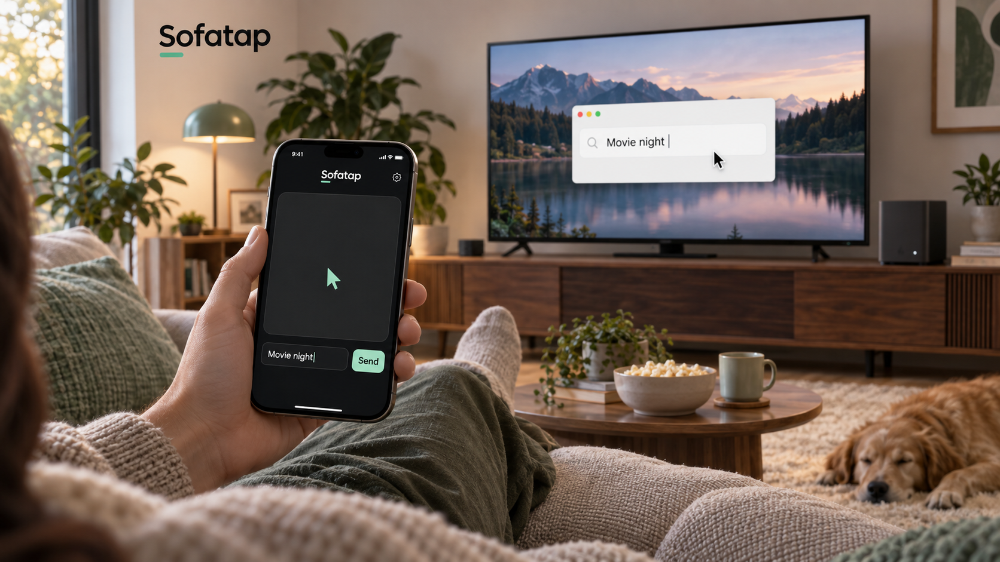

# Sofatap

[English](README.md) · **简体中文** · [日本語](README.ja.md)

**把 iPhone 变成客厅电脑的遥控器。**



*AI 生成的产品场景示意图，并非应用截图。*

Sofatap 是 [chekusu](https://github.com/chekusu) 开发的开源遥控工具。把 iPhone 变成 Windows、Mac 或受支持 Linux 电脑的手势鼠标和语音／文字输入器。电脑画面留在电视上，人坐在沙发上就能操作。

[下载版本](https://github.com/chekusu/sofatap/releases) · [问题反馈](https://github.com/chekusu/sofatap/issues) · [MIT 许可](LICENSE)

## 宣传视频

[](https://sofatap.app/zh/#video)

一分钟短片：手势指针、手机键盘打字、语音听写，坐在沙发上就能完成。[在 sofatap.app 观看宣传视频](https://sofatap.app/zh/#video)，或下载带字幕的 MP4：[简体中文](https://sofatap.app/exports/sofatap-promo-zh-cn.mp4) · [英文](https://sofatap.app/exports/sofatap-promo-en.mp4)。

## 可以做什么

- 一个大圆角触控区域，容纳 logo、扫码、麦克风和键盘入口。背景铺满缓慢流动的点阵，触摸会使附近点阵弯曲、偏移，点击产生涟漪。触控面不放说明文字；开启「减弱动态效果」后点阵保持静止，触摸反馈简化。
- 滑动移动鼠标、单击左键、连续双击右键、停留 300 ms 后拖动、双指滑动滚动。
- 点击底部麦克风使用设备支持的本机语音识别，也可使用 iPhone 键盘／Typeless。受支持的输入框默认实时同步：键盘确认的文字、删除、选区和语音识别更新直接反映到电脑，无需点**发送**。其他输入框及旧接收端保留检查草稿后发送；不会额外追加回车或提交操作。
- 扫描**电脑原生窗口**里的二维码配对：Mac 使用 AppKit/SwiftUI，Windows 使用 WinForms，Linux 使用 GTK3，无需打开浏览器。
- 三端接收器采用已选定的**暮色薄荷**设计：深灰底色、薄荷绿操作按钮与清晰的白底二维码。参见[设计规格](docs/RECEIVER-DESIGN.md)；此次更新位于开发源码，下方旧版下载尚未包含。
- 通过家庭局域网连接，使用 WSS/TLS、证书指纹校验和本地配对凭据。电脑上的修改与当前编辑冲突或连接中断时，实时输入会暂停；结果不确定的编辑不会自动重放。

**当前是 alpha 预览版。** 实时文字编辑位于 `main` 的 0.7.0 开发源码（iPhone build 10）中，下方下载仍是先前 alpha 版本。[0.7.0 真机到 Windows 限定验收](docs/verification/realtime-input-0.7.0.md)已通过原生 RichEdit 字段的已有文字导入、多语言／emoji／换行追加、键盘删除、全选和清空；实时语音及其他项目仍待验收。[0.6.0 记录](docs/verification/2026-10-13-iphone-input.md)另有手势、麦克风听写和明确发送的结果。蓝牙连接和云中继尚未实现。参见[交互规格与后续独立 CUA 方向](docs/INTERACTION.md)。

点击 logo 查看连接详情和手势帮助。需要输入时，编辑区才出现在触控区域下方；受支持的输入框直接实时编辑，其他输入框保留草稿检查与明确发送。[查看离线模拟器界面](docs/images/sofatap-single-screen.png)与[点阵动效预览](docs/images/sofatap-touch-effects.mp4)。这些仅展示本地渲染，不代表真实 iPhone 输入或性能已验证。

兼容接收端识别到提供辅助功能元数据的新可编辑输入框时，手机会自动弹出键盘。后台检测不读取框内内容；随后打开实时编辑会话时，会把受支持字段的完整文字和选区传到配对手机，因此退格、全选后删除也能修改电脑上的已有文字。焦点检测与实时编辑的支持范围不同：Windows 实时编辑当前限原生 Edit/RichEdit 控件；Mac 要求辅助功能提供可写的选中文字及选区。缺少相应能力的浏览器、自绘控件、Linux 及旧接收端采用检查草稿后发送。密码和只读字段不能开启实时编辑。参见[焦点检测、数据处理及平台限制](docs/TEXT-FOCUS.md)。

**Windows 锁屏 PIN 控制（验证中）：** 目标是用 iPhone 触控板操作锁屏并手动输入 PIN，再提供可选的 Face ID 授权自动输入已保存 PIN。Sofatap 不要求 Microsoft 账户密码。此前的账户密码实验已停用，普通接收器和 iPhone UI 不再提供入口。鼠标探测、原生 PIN 接受和手机联合实测分别验收，扫码配对或编译成功不代表已支持。参见[范围与验证](docs/FACE-ID-UNLOCK.md)。

## 平台进度

| 平台 | 当前状态 |
| --- | --- |
| iPhone | iOS 17+。0.7.0 (10) 已通过 Windows RichEdit 测试字段的真实导入、追加、删除和选区同步；实时语音及更多场景仍待验收。 |
| Windows | 0.3.0 原生接收端已发布。开发源码支持原生 Edit/RichEdit 实时编辑；限定 RichEdit 真机键盘验收已通过，其他设备项目仍待完成。 |
| Mac | macOS 15+。Apple Silicon 和 Intel 包均已公证；Apple Silicon 完成部分真机验收，Intel 输入待实测。 |
| Linux | 0.4.0 GTK3 原生接收端已发布；X11 输入通过隔离桌面检查。Wayland portal 为实验支持；真手机联调、真实 Wayland 合成器和 ARM64 运行待测。 |

[Mac 验收记录](docs/verification/macos-0.3.0.md)覆盖了 2026-10-11 的真实相机扫码、TLS 连接、文字精确读回和部分按键、指针操作。[Linux 验收记录](docs/verification/linux-0.4.0.md)覆盖原生 GTK 渲染、独立 Xvfb 桌面上的 X11 输入，以及私有 D-Bus 上的模拟 Wayland portal。这些记录不代表所有应用的兼容性均已验证。

鼠标、快捷键和回退的整段文字输入在 Windows 使用 Win32 `SendInput`，Mac 在用户明确授予辅助功能权限后使用 Quartz。实时文字改用 Win32 Edit/RichEdit 消息或 Mac 辅助功能选中文字操作，修改后读回核对，并保留差异区段以外的文字。Linux X11 需要 libX11、libXtst 和 libxdo；Wayland 需要兼容的 RemoteDesktop portal 与系统原生权限授权。Linux 当前仍采用检查草稿后发送，每次文字操作最多 2,048 个 Unicode 标量值，不读取或替换剪贴板。未支持的 Wayland 会话保持不可用，不回退到 XWayland。参见 [Linux 要求与限制](desktop/linux/README.md)。

## 开始使用

### 安装电脑接收端

| 电脑 | 下载 | 安装说明 |
| --- | --- | --- |
| Windows x64 | [v0.3.0-alpha](https://github.com/chekusu/sofatap/releases/tag/v0.3.0-alpha)：`SofaTap-Windows-x64.zip` 及对应 `.sha256` | 解压并运行 `SofaTap.exe`，防火墙只允许可信家庭专用网络访问。[Windows 启动说明](docs/WINDOWS-START.md) |
| Mac | [v0.3.0-alpha](https://github.com/chekusu/sofatap/releases/tag/v0.3.0-alpha)：`SofaTap-macOS-arm64-notarized.zip` 或 `SofaTap-macOS-x64-notarized.zip` 及对应 `.sha256` | 根据电脑选择 Apple Silicon 或 Intel 包，两者均已公证。见 [Mac 安装与授权说明](docs/MAC-START.md)。 |
| Linux x64 / ARM64 | [v0.4.0-alpha](https://github.com/chekusu/sofatap/releases/tag/v0.4.0-alpha)：`SofaTap-Linux-x64.tar.gz` 或 `SofaTap-Linux-arm64.tar.gz` 及对应 `.sha256` | 安装系统 GTK 和输入依赖后，解压并运行 `./sofatap`；原生窗口包含 Wayland 授权入口。[Linux 启动说明](desktop/linux/README.md) |

电脑端包已包含 .NET 运行时。Linux 仍需安装指南中列出的系统依赖。`--dry-run` 可演练连接流程，不产生桌面输入。

### 安装 iPhone App 并配对

1. 在 Xcode 中打开 `ios/SofaTap.xcodeproj`，选择自己的开发团队和已连接的 iPhone，然后运行 App。安装需要有效开发签名、设备配对和开发者模式。见 [iOS 构建说明](ios/README.md)。
2. 将 iPhone 与电脑接入可互通的家庭网络。访客 Wi-Fi 的设备隔离可能阻止连接。
3. 用 iPhone App 扫描接收端原生窗口里的二维码，或粘贴完整配对链接。
4. 在电脑上选中输入框，再打开手机键盘或麦克风。受支持的字段自动同步打字、删除和识别文字；其他字段显示**发送**按钮，供检查草稿后发送。焦点冲突或断线导致实时输入暂停时，先检查电脑，再明确重新打开编辑器；不确定的编辑不会自动重放。

配对链接含有控制凭据，应只保留在自己的设备上。如果从最早使用 **Tiltro** 名称的版本升级，请阅读[升级说明](docs/WINDOWS-START.md#从旧名称版本升级)：这些版本的标识和存储位置不同，其配对和草稿不会自动迁移。本次 Sofatap 品牌拼写统一会保留现有 Sofatap 配对。

## 隐私与权限

Sofatap 通过局域网直接连接，项目没有云中继服务。配对使用固定证书校验；凭据保存在 iPhone Keychain、Windows DPAPI 或 Mac/Linux 上仅当前用户可读的接收端文件中。Mac 输入需要辅助功能权限，Wayland 输入需要用户明确授予 portal 权限。

麦克风仅在明确点击并取得所需权限后启动。受支持的本机识别将音频保留在手机上；Sofatap 不上传音频，也不静默切换到云端识别。实时编辑时，识别过程中的文字和后续修正会同步到电脑；回退的草稿模式仍需点**发送**。系统听写和第三方输入法有各自的数据处理方式。

实时编辑通过固定证书校验的 TLS，把当前受支持输入框的完整文字及选区直接传到配对手机。导入的实时文字仅保留在手机内存中，不写入已保存草稿的偏好设置。接收端在当前连接的有界内存缓存中保留带文字的确认消息，用于防止重复编辑，连接结束后不再保留该缓存。独立的检查后发送草稿仍会保存在本机以便恢复。字段文字不记录日志、不发送到云服务；后台焦点提示仍只包含元数据。

二维码通过本机私有管道传给原生电脑 UI，不使用网页配对。不要公开配对码、凭据或签名材料。仓库不包含开发账号、签名证书或 provisioning profile。通信与输入行为见 [PROTOCOL.md](PROTOCOL.md)，待完成的设备检查见[实机验收清单](docs/ACCEPTANCE.md)。

## 从源码构建

接收端需要 **.NET 10 SDK** 和 Python 3。如果 SDK 在自定义位置，将 `SOFATAP_DOTNET` 设为 `dotnet` 可执行文件路径。

```sh
# 在 Mac/Unix 上构建 Windows 分发包
bash scripts/build-windows.sh

# 在 macOS 上构建 Mac 分发包
bash scripts/build-macos.sh arm64
bash scripts/build-macos.sh x64

# 构建 Linux 分发包，支持交叉构建
bash scripts/build-linux.sh x64
bash scripts/build-linux.sh arm64
```

产物写入 `artifacts/`，附带许可和 SHA256 文件。Windows 和 Mac 包分别命名为 `SofaTap-Windows-x64.zip`、`SofaTap-macOS-<architecture>.zip`；Linux 为 `SofaTap-Linux-<architecture>.tar.gz`。Mac 默认使用 ad-hoc 开发签名；分发签名和 Apple 公证流程见 [NOTARIZATION.md](docs/NOTARIZATION.md)。

Windows 开发者可在 PowerShell 中构建底层接收组件；上面的完整分发包还包含原生窗口：

```powershell
dotnet publish host/SofaTap.Host.csproj -c Release -r win-x64 --self-contained true -p:PublishSingleFile=true -p:IncludeNativeLibrariesForSelfExtract=true
```

分发构建产物时需附上 `LICENSE`、`THIRD-PARTY-NOTICES.md` 和对应依赖许可。打包脚本会收集实际解析到的运行时及 NuGet 版本的许可。

iPhone 使用仓库中的 Xcode 工程。修改 `ios/project.yml` 后，运行 `xcodegen generate --spec ios/project.yml` 重新生成工程。[iOS 说明](ios/README.md)也介绍了直接编译方式；设备编译成功不等于签名和安装已完成。

## 开发验证

在装有 .NET 10、Python 3 和 Xcode 的 Mac 上运行：

```sh
python3 -m pip install websockets==16.0
dotnet run --project tests/host/SofaTap.Host.Tests.csproj -c Release
dotnet run --project desktop/windows-login/Tests/Sofatap.Login.Tests.csproj -c Release
SOFATAP_DOTNET="$(command -v dotnet)" python3 tests/smoke.py
swiftc ios/SofaTap/Core/Pairing.swift tests/PairingTests.swift -o /tmp/sofatap-pairing-tests
/tmp/sofatap-pairing-tests
swiftc ios/SofaTap/Core/ReceiverState.swift tests/ReceiverStateTests.swift -o /tmp/sofatap-receiver-tests
/tmp/sofatap-receiver-tests
swiftc ios/SofaTap/Core/TouchGestureState.swift tests/TouchGestureTests.swift -o /tmp/sofatap-gesture-tests
/tmp/sofatap-gesture-tests
python3 tests/text_focus_linux.py
bash ios/scripts/build-manual.sh device
```

Host runner 使用模拟输入器。TLS/WebSocket 检查以 `--dry-run` 启动临时接收端，不向系统注入输入。最后一项编译未配置签名的 ARM64 iOS App，不安装到手机。CI 还执行各平台构建和隔离 Linux 桌面检查；相关命令见 [Linux 说明](desktop/linux/README.md#lifecycle-and-checks)。

构建、协议、虚拟桌面和物理设备检查分别证明不同层面的行为。[0.7.0 真机记录](docs/verification/realtime-input-0.7.0.md)确认 RichEdit 导入、追加、删除和选区同步。实时语音、普通 Edit、文字中段替换、冲突、重连、Mac 实时编辑、Typeless 及更多应用尚不在已完成范围内。

## 源码目录

| 路径 | 内容 |
| --- | --- |
| `ios/` | 原生 iPhone App、Xcode 工程和工程生成配置 |
| `host/` | 共用接收协议、Windows/Mac 输入后端和 Linux worker 桥接 |
| `desktop/` | 原生配对窗口和 Linux 输入 worker |
| `tests/` | 协议、认证和输入边界检查 |
| `PROTOCOL.md` | 通信协议 |
| `docs/` | 安装指南和验收记录 |
| `scripts/build-*.sh` | 电脑端分发包构建 |
| `licenses/` | 第三方许可与通知原文 |

本机构建产物、配对凭据和签名材料不属于源码。命名背景见 [NAME.md](docs/NAME.md)。

## 参与和许可

欢迎提交 Issue 和 Pull Request，参与前请阅读 [CONTRIBUTING.md](CONTRIBUTING.md)。

Sofatap 采用 [MIT 许可](LICENSE)。第三方依赖通知见 [THIRD-PARTY-NOTICES.md](THIRD-PARTY-NOTICES.md)。
