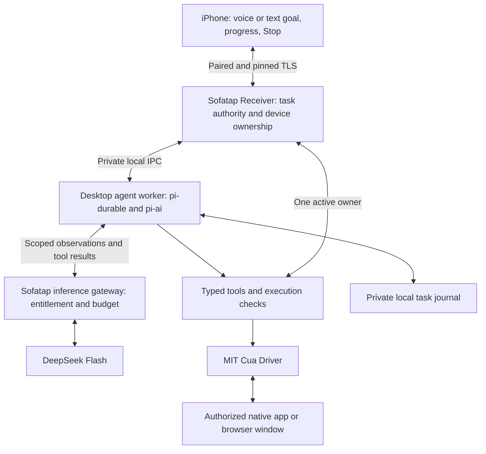

# Sofatap Pro: natural-language computer control

Research date: **2026-10-13, Asia/Tokyo**. Status: **architecture proposal**, not an implemented feature or release commitment. “Sofatap Pro” is a working paid-tier name.

## Recommendation

This research is for the **paid voice-automation feature**, scheduled after the next free manual TV-control feature. The user's [product roadmap](../ROADMAP.md) takes precedence over the prototype sequence below: free TV remote first, paid Windows/macOS/Linux automation second, paid TV automation third. Manual mouse control, keyboard input and speech-to-text dictation remain separate basic features.

When the paid desktop stage begins, evaluate a bounded prototype combining **pi-durable for task orchestration, Cua Driver for local desktop observation/actions, and DeepSeek Flash for language and visual decisions**. This can run independently of Codex. It is not a dependency for free TV control.

The premium outcome should be: **say what you want, let the computer complete several steps, and take over whenever needed**. Examples to qualify include opening an installed game, searching for a trailer and entering full screen, or opening a chosen local video. Success means the requested application reaches the desired state, not just that a sequence of clicks was delivered.

The combination is technically plausible from source inspection. Desktop accuracy, latency, recovery reliability and customer support cost remain unmeasured. Charge for a supported, maintained service after those are demonstrated.

## What was checked

| Component | Pinned evidence | Role and limitation |
| --- | --- | --- |
| Pi | [`7d75a0e3eb273dff753d49c066ea29fbe7b3b6f6`](https://github.com/earendil-works/pi/commit/7d75a0e3eb273dff753d49c066ea29fbe7b3b6f6), pi-durable / pi-ai 1.2.0 | Persistent conversations/tasks and model tools; API explicitly experimental |
| Cua | [`7a1dcd01874647f1b65673b190a43db5e1194d2b`](https://github.com/trycua/cua/commit/7a1dcd01874647f1b65673b190a43db5e1194d2b) | Driver observations and actions; application/platform support varies |
| Cua release to evaluate | [Driver 0.34.1](https://github.com/trycua/cua/releases/tag/cua-driver-rs-v0.34.1), tag commit `0c69d9a2c8abbb5051a2df4a23f0fa166d5385dc` | Released on October 9; HEAD APIs must not be assumed present in this binary |
| DeepSeek | [Current model table](https://api-docs.deepseek.com/quick_start/pricing/) and [vision contract](https://api-docs.deepseek.com/guides/vision/) | `deepseek-flash` is V4.1-Flash with images; `deepseek-v4-pro` is text-only |
| Sofatap | Implementation `01b8990d30e070e07edf4ba039ebfc832df272bd`; acceptance record at `65bf822` | Existing authenticated local transport, native receivers and phone input; no agent runtime yet |

Research inspected public documentation, source and package metadata. No upstream software was installed or executed, no paid inference was requested, and no desktop or phone input was sent. Existing [0.7.0 acceptance](../verification/realtime-input-0.7.0.md) does not validate this proposed agent.

## Architecture

Use a supervised desktop worker with bundled Node and the Driver's native bindings. This keeps the Pi and Driver TypeScript interfaces in one process and avoids writing three language bridges first. Start with the direct TypeScript SDK; stdio MCP is an alternative for a small spike if the pinned SDK artifact lacks a required API. Neither route needs Codex. Pin the native library and bindings together. A later C ABI bridge into .NET/Swift is possible custom work, not a ready-made Driver C#/Swift SDK. See the [TypeScript boundary](https://github.com/trycua/cua/blob/7a1dcd01874647f1b65673b190a43db5e1194d2b/libs/cua-driver/typescript/README.md) and [native ABI](https://github.com/trycua/cua/blob/7a1dcd01874647f1b65673b190a43db5e1194d2b/libs/cua-driver/rust/include/README.md).

The worker owns planning and task state. The receiver remains the authority for the selected device, application scope, cancellation and exclusive input ownership. The inference gateway holds company API credentials and enforces entitlement and spend limits; it is not an arbitrary remote-command endpoint. The paid build needs a provider/base-URL adapter for this authenticated gateway; that adapter has not been built or tested. A self-hosted/BYOK path can be evaluated separately for developers.

Keep the existing on-device speech recognizer for transcription. The reviewed DeepSeek interfaces establish text/image inference, not a replacement live audio recognizer. Audio can remain on the phone while command text and approved desktop observations are processed by the model provider.

### Changes needed in Sofatap

Current [`ReceiverServer`](../../host/ReceiverServer.cs) permits one controlling connection. [`ActionSession`](../../host/Protocol.cs) remembers duplicate IDs only in that connection's memory. [`PROTOCOL.md`](../../PROTOCOL.md) intentionally has no general screen capture, tool execution or task persistence.

Add a negotiated agent capability, a receiver-owned task broker and a separate bounded task/event channel. Pairing for manual control must not automatically authorize cloud observation or unattended execution. Do not enlarge the existing 64 KiB control frames to carry arbitrary screenshots or expose a shell through the old action parser. Observation data stays on the desktop-to-model path unless the phone explicitly needs a preview.

Expose a small tool set: discover permitted apps, observe one exact window, open a permitted app, act on an observed element, type, scroll, and check the result. Prefer accessibility/DOM identifiers; use screenshot coordinates only with the matching fresh image, dimensions and scale. Each dependent action gets a new observation. Do not nest another autonomous agent inside a Pi tool.

Enforce this scope in the Driver's `bounded` mode using a receiver-generated capability manifest loaded at startup: allowed tools, exact executable/bundle identities, necessary file roots, expiry and idle timeout. The model must not control that configuration. The default `standard` mode allows broad ordinary desktop actions; limiting the tools described to the model is insufficient. Source: [Driver permissions](https://github.com/trycua/cua/blob/7a1dcd01874647f1b65673b190a43db5e1194d2b/docs/content/docs/cua-driver/guides/permissions.mdx).

Attaching CDP to an existing logged-in browser needs a separate grant; setup can enable persistent remote debugging that session teardown does not disable. Initially prefer native interaction or a separately consented browser profile. An origin-restricted browser manifest needs its own runtime, with the desktop runtime scoped away from that browser: generic desktop input would bypass the origin boundary. Sources: [browser setup](https://github.com/trycua/cua/blob/7a1dcd01874647f1b65673b190a43db5e1194d2b/docs/content/docs/cua-driver/guides/browsers.mdx), [manifest restrictions](https://github.com/trycua/cua/blob/7a1dcd01874647f1b65673b190a43db5e1194d2b/docs/content/docs/cua-driver/guides/permissions.mdx).

## Pi and DeepSeek integration

Pi provides `Harness.open`, submissions with a deduplication `requestId`, watchers, checkpoints and abort. It requires Node >=22.19. Its storage contract is single-owner; SQLite's database locks are not a multi-process task lease. The default Node SQLite adapter uses WAL with `synchronous=NORMAL`, so sudden power loss is a distinct durability test. Pin the experimental API behind a Sofatap adapter. Sources: [manifest](https://github.com/earendil-works/pi/blob/7d75a0e3eb273dff753d49c066ea29fbe7b3b6f6/packages/durable/package.json), [Harness](https://github.com/earendil-works/pi/blob/7d75a0e3eb273dff753d49c066ea29fbe7b3b6f6/packages/durable/src/harness/harness.ts), [storage](https://github.com/earendil-works/pi/blob/7d75a0e3eb273dff753d49c066ea29fbe7b3b6f6/packages/durable/src/storage/sqlite/node.ts).

Use Pi's existing `deepseekProvider()` and `{ provider: "deepseek", modelId: "deepseek-flash" }` through Chat Completions. The inspected published pi-ai 1.2.0 catalog includes Flash image input. Its serializer preserves DeepSeek reasoning fields and converts tool-result images to adjacent user image messages. A custom CUA tool wrapper is still required, but a new model provider is not the starting point. This path has been inspected, not run. Sources: [provider](https://github.com/earendil-works/pi/blob/7d75a0e3eb273dff753d49c066ea29fbe7b3b6f6/packages/ai/src/providers/deepseek.ts), [serializer](https://github.com/earendil-works/pi/blob/7d75a0e3eb273dff753d49c066ea29fbe7b3b6f6/packages/ai/src/api/openai-completions.ts), [published package](https://registry.npmjs.org/@earendil-works/pi-ai/1.2.0).

DeepSeek supports ordinary function tools. Its Responses compatibility is stateless and ignores built-in `computer_use`/MCP, `parallel_tool_calls` and `max_tool_calls` controls. Sofatap must implement tools, history, sequencing and budgets itself. For Pi, explicitly use sequential execution and still enforce a device-wide lock. Preserve reasoning/tool/image history correctly; validate every tool argument locally even if strict schemas are enabled. Sources: [function tools](https://api-docs.deepseek.com/guides/tool_calls/), [Responses compatibility](https://api-docs.deepseek.com/guides/responses_api/).

Start with Flash for both reasoning and screenshots. Introduce a second planner/visual model only if evaluation shows a benefit. Image support is not evidence of reliable pixel targeting. Model aliases can change behavior, so record returned model metadata and run a small qualification suite when providers change.

## Continuous work and recovery

Proposed task states: `queued → observing → planning → acting → verifying`, with exits to `completed`, `needs_user`, `paused`, `cancelled` or `failed`. “Open another result” can update the active goal, but must trigger fresh observation rather than append a guessed click sequence.

Pi's tool replay default is `unsafe`; interrupted mutations do not become safe merely because the task was persisted. Its `beforeTool` hook can reject a call, but does not supply a complete durable mobile approval flow. Sources: [tool execution/recovery](https://github.com/earendil-works/pi/blob/7d75a0e3eb273dff753d49c066ea29fbe7b3b6f6/packages/durable/src/harness/tool.ts), [submission steering](https://github.com/earendil-works/pi/blob/7d75a0e3eb273dff753d49c066ea29fbe7b3b6f6/packages/durable/src/harness/types.ts).

Sofatap must add these guarantees:

- One task or manual controller owns desktop mutation. Manual takeover revokes agent ownership before the next action. Sequential tools within one conversation do not prevent a second process from racing it.
- Record action intent before execution and distinguish `verified`, `not_executed` and `uncertain` afterward. Include task/action IDs, device-session generation, exact target and observation version. Persisting the receipt and changing an external app cannot form one atomic transaction: **do not promise exactly-once GUI effects**.
- After a crash or lost response, re-observe and reconcile. Never retry an uncertain send, purchase, deletion or form submission just because the result is absent. If the external state cannot prove what happened, pause for the user.
- Keep snapshots versioned and expiring. A “safe” replayed observation is useful for reconstructing history, but must never authorize a new mutation without a fresh current observation.
- Stop works through the receiver independently of a stalled model request. Revoke the lease, prevent queued actions, request worker cancellation and release owned held input. Already completed external effects are not undone by Stop.
- Bind consequential-action approval to the exact action, arguments, target, observation and expiry. Screen/webpage text is task data, never permission to widen the scope.

For the first beta, phone backgrounding/disconnection pauses new mutations at a bounded safe point. Task history survives; resumption requires a current observation and the user returning. Later, an explicit “continue on this computer” mode could permit bounded desktop execution while the phone sleeps. Do not make iOS background execution the task engine.

## Platform scope

| Platform | Initial target | Boundary to expose honestly |
| --- | --- | --- |
| Windows | Unlocked user session; native apps and qualified Chromium flows | Same interactive console/RDP session. Elevated windows, secure desktop and Session 0 are separate limitations. RDP success does not prove HDMI-console behavior. |
| Mac | Qualified AppKit/SwiftUI/browser windows; Developer ID receiver | Accessibility and Screen Recording permissions. Some minimized/off-Space/custom apps reject background actions. |
| Linux | X11 with a tested GTK/Qt/browser matrix | Wayland is compositor-specific; Sway, GNOME, KDE and Hyprland have different support and setup. Qualify separately as preview. |

Sources: [Driver platform matrix](https://github.com/trycua/cua/blob/7a1dcd01874647f1b65673b190a43db5e1194d2b/docs/content/docs/cua-driver/concepts/platform-support.mdx), [remote sessions](https://github.com/trycua/cua/blob/7a1dcd01874647f1b65673b190a43db5e1194d2b/docs/content/docs/cua-driver/guides/vms-and-remote.mdx).

Use Yomado for shared-Mac test placement, retaining physical topology and verifying actual input isolation. A virtual display or an agent cursor is not a separate OS input session. Games/canvas/HID-only apps may need an explicitly dedicated foreground session; never silently fall back to it. Locked-computer/PIN operation remains a separate project.

The Mac Driver's background input includes private SkyLight SPI. A public `CGEvent::post_to_pid` fallback exists, but does not establish equivalent behavior in Chromium/Catalyst. Keep the Driver in the desktop receiver, preserve the signed permission-owning launch chain, and qualify new macOS versions independently. This is a material obstacle to a future Mac App Store version, not a guarantee of rejection or of successful Developer ID distribution. Source: [Mac input implementation](https://github.com/trycua/cua/blob/7a1dcd01874647f1b65673b190a43db5e1194d2b/libs/cua-driver/rust/crates/platform-macos/src/input/skylight.rs).

## Paid tier and distribution

Proposed split:

| Base remote | Pro service |
| --- | --- |
| Manual gestures, keyboard, dictation and native pairing | Natural-language multi-step tasks, follow-up corrections, task progress/recovery, maintained app adapters and bundled inference |

Offer a subscription with a clear monthly AI allowance and per-task limits. Measure before choosing the retail price. An “unlimited” promise would hide variable retries and long reasoning loops. Handle refunds/expiry and quota errors without disabling manual control or abandoning held inputs.

Sofatap's [MIT license](../../LICENSE) permits forks; a local paid-feature flag is not a durable commercial boundary. Sell convenience, signed updates, support and hosted inference. Verify service entitlement and budget on the server; never embed a company model API key in the app. Keep the underlying open-source receiver usable independently.

For iOS, plan StoreKit in-app purchases for unlocking the premium feature, with server-side entitlement verification; regional alternatives need separate review. Apple requires disclosure and explicit permission for sharing personal data with third-party AI. Remote-desktop Guideline 4.2.7 has a narrower conditional scope than a blanket ban on all cloud-assisted remotes; assess the actual product at submission. Keep desktop execution on the user's computer and retain the Mac Developer ID distribution path. These are design constraints, not a prediction of App Review approval. Source: [App Review Guidelines 3.1, 4.2.7 and 5.1.2](https://developer.apple.com/app-store/review/guidelines/).

### Indicative inference cost

As checked on October 13, Flash peak pricing is $0.30 per million uncached input tokens and $1.20 per million output tokens; off-peak is half. These examples sum tokens across **all requests**, including repeated history, image tokens and reasoning output. They are budgets, not measurements:

| Hypothetical cumulative input / output | Flash peak model cost |
| --- | ---: |
| 40,000 / 5,000 | $0.018 |
| 200,000 / 20,000 | $0.084 |
| 1,000,000 / 100,000 | $0.420 |

Formula: `(input × 0.30 + output × 1.20) / 1,000,000`. This excludes hosting, support, payment/store charges, taxes and work exceeding the stated budgets. Track **cost per successful task**, p95 duration and intervention rate, not only token price. Source: [DeepSeek pricing](https://api-docs.deepseek.com/quick_start/pricing/). A low inference estimate does not establish a viable retail margin.

## Licensing and data before commercial release

Pi and the selected Cua Driver core are MIT; retain required notices and audit the actual packaged dependency set. **Do not treat the entire Cua monorepo as MIT.** Spaces components and Driver Bench use FSL; optional perception includes an AGPL detector. The current root README and component licensing disagree about some streaming pieces: the actual `cua-media-protocol` and `cua-media-transport` license files say FSL. The recommended prototype omits these components. Sources: [Pi license](https://github.com/earendil-works/pi/blob/7d75a0e3eb273dff753d49c066ea29fbe7b3b6f6/LICENSE), [Cua license map](https://github.com/trycua/cua/blob/7a1dcd01874647f1b65673b190a43db5e1194d2b/LICENSING.md), [commercial scope](https://github.com/trycua/cua/blob/7a1dcd01874647f1b65673b190a43db5e1194d2b/COMMERCIAL.md), [media protocol license](https://github.com/trycua/cua/blob/7a1dcd01874647f1b65673b190a43db5e1194d2b/libs/cua/crates/cua-media-protocol/LICENSE), [perception notices](https://github.com/trycua/cua/blob/7a1dcd01874647f1b65673b190a43db5e1194d2b/libs/cua-driver/docs/perception-third-party-notices.md).

The proposed mode changes Sofatap's current local-only data contract: approved app text/screenshots may reach the inference gateway and DeepSeek. Explain this when enabling AI control. Restrict observation to selected targets, exclude credential surfaces, redact before persistence/upload, and make history deletion available. Semantic text can be sensitive too. Pi persistence requires a deliberate encrypted/local retention design; do not claim screenshots remain ephemeral if they are embedded in saved model transcripts.

DeepSeek's Open Platform terms allow downstream applications, require key protection and downstream data disclosures, and contain broad output-reliance language in section 8.1. Clarify commercial autonomous-action and API data-processing terms before a paid launch. The reviewed public policy does not establish an API-specific zero-retention/no-training guarantee for Sofatap screenshots; `store:false` is not such a guarantee. Sources: [Open Platform terms](https://cdn.deepseek.com/policies/en-US/deepseek-open-platform-terms-of-service.html), [privacy policy](https://cdn.deepseek.com/policies/en-US/deepseek-privacy-policy.html?locale=en_US).

## Paid desktop implementation gates, after free TV control

1. **Provider/driver spike:** pin release artifacts, package the desktop worker, and complete observe → plan → one reversible action → native readback in isolated Windows, Mac and Linux X11 fixtures. Verify actual tool/image/reasoning round trips, cancellation and usage reporting. No paid beta claim yet.
2. **Continuous task prototype:** qualify three short living-room scenarios per OS, then a fixed corpus of 20 tasks × five runs per supported platform. Include Chinese, Japanese and English goals, a mid-task correction, mixed DPI and a changed window. Count a task only when its final state is independently verified.
3. **Recovery and refusal:** inject crashes before/after mutation and before/after receipt persistence, lost responses, restart with pending approval, two simultaneous jobs, manual takeover, missing permissions, lock/sleep/RDP disconnect and malicious page text. Unknown outcomes pause; no stale or duplicate mutation is acceptable in this suite.
4. **Private alpha to paid beta:** proposed gate is at least 95/100 complete tasks on each advertised platform, zero wrong-target or duplicated consequential actions in the fixed suite, measured p50/p95 latency and cost, working Stop/recovery, signed installers, permission onboarding and subscription lifecycle checks. This threshold is a release proposal, not a safety guarantee or achieved result. Wayland enters only after its own compositor-specific qualification.

Keep recorded dependency SHAs, model identifier/date, supported app/OS versions and reproducible outcome checks with each evaluation. The first engineering task within the later paid desktop stage is the bounded spike; a broad “operate any application” promise would outrun the evidence. This does not replace the current free TV-control milestone.
