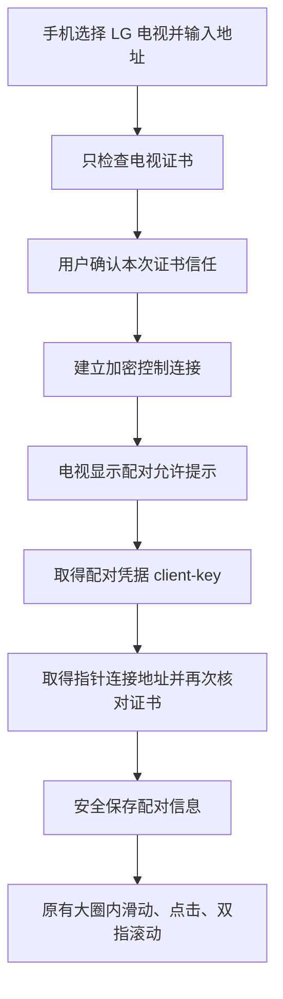

# Sofatap 电视遥控：中文技术方案与当前进度

更新日期：**2026 年 10 月 13 日**。本说明配合[英文完整方案](tv-implementation-plan.md)阅读。英文版保留了固定版本的源码链接、协议细节和安全分析；本文重点说明为什么这样实现、目前做到哪里，以及下一步如何验收。

**当前已经写出原生 LG webOS 指针遥控预览，但还没有完成真实电视验收。** 本机协议测试和真实 TLS/WebSocket 测试通过，说明软件在这些测试条件下行为正确，不能据此宣布某款电视已经兼容。自动发现、电视文字输入和电视语音输入仍未接入。

**下一项开发优先级已调整为 Android/Google TV 接收端能力验证。** LG 预览保留为独立适配器，后续 Android 开发不必等待 LG 真机验收。目前尚未产出 Android 接收包，也未确认任何 Android TV 型号已经兼容。

## 一、产品顺序与收费边界

按[产品路线图](../ROADMAP.md)推进：

1. **先做免费电视遥控。** 手机直接连接电视，完成手动触控操作；电脑遥控继续保留。普通打字和语音转文字属于基础输入能力。
2. **再做付费电脑语音自动化。** 用户说出目标，由软件连续操作 Windows、macOS、Linux，并显示进度、允许停止和接管。
3. **最后扩展付费电视自动化。** 在已经验证的电视控制和画面观察能力上完成任务。

免费电视遥控不依赖 Codex、DeepSeek、订阅或云端账户。把语音识别成文字，与“帮我打开应用并完成一串操作”，是两项不同功能。后者的 pi-durable、Cua 与 DeepSeek 架构见[付费电脑自动化研究](natural-language-pro.md)。

## 二、当前优先做 Android 接收端，保留 LG 预览

计划用同一套原生 Android TV 接收端覆盖不同品牌，通过能力检测和逐型号验收处理差异。接收端用原生 UI 显示配对二维码、连接状态与权限引导；第一次安装仍需现有遥控器完成操作。扫码只建立配对关系，不代表取得鼠标或输入法权限。配对凭据应一次性使用、短期有效并绑定接收端身份，后续通信经过认证，支持撤销；二维码、密钥和输入内容不进入日志。

首个安装包先验证能力：电视是否提供触摸或模拟触摸特征，无障碍节点能否实际点击和滚动，以及可选输入法能否编辑当前焦点。覆盖桌面、设置和代表性第三方 App，不能只在我们自己的页面上验证。自由光标、节点点击和方向导航分别记录；只有实际操作生效，才能宣称相应支持。

测试和直接安装产出 **APK**，未来提交 Google Play TV 产出 **AAB**，共用一个工程。电视入口、无需触屏、遥控器操作、商店质量和架构要求都需满足。安装包本身不授予系统输入权限，也不保证商店审核通过。[Android TV 原生工程](https://developer.android.com/training/tv/get-started/create)、[发布要求](https://developer.android.com/training/tv/publishing/distribute)

前期 LG 预览的协议依据仍有效，但不再作为下一阶段的优先目标：

LG 的本地协议提供真实的相对指针移动、点击和滚动。手机发送移动量，电视移动自己的光标；手机上画一个动画并不算完成这个能力。ConnectSDK 源码明确实现了 `move(dx, dy)`、`click` 和 `scroll(dx, dy)`。[LG 指针接口源码](https://github.com/ConnectSDK/Connect-SDK-Android-Core/blob/2f7ebbc7eb909321ff41b2c6bcdf6b0881427579/src/com/connectsdk/service/webos/WebOSTVMouseSocketConnection.java#L135)

Google/Android TV 常见的 Remote v2 接口则提供方向键、确认、文字等功能。当前核查的协议中没有相对鼠标移动或滚轮消息。滑动后选中下一张卡片，是方向导航；把光标移到任意位置，是鼠标操作，必须分别标明。[Remote v2 消息定义](https://github.com/tronikos/androidtvremote2/blob/e664a8e1f14ee458b14c646bfb3ea46f10367051/src/androidtvremote2/remotemessage.proto#L846)

| 能力 | 当前 LG 预览代码 | Google/Android TV 研究结论 |
| --- | --- | --- |
| 滑动移动自由光标 | 已接入协议及手机手势，待真机验收 | Remote v2 未发现对应接口 |
| 单击 | 发送指针点击 | 可发送确认键，作用于当前焦点 |
| 双指滚动 | 已接入纵向滚动，待逐应用验证 | 方向键翻动列表不能算滚轮 |
| 返回、主页 | 已放入原有触控界面 | 可通过按键协议实现，尚未接入 Sofatap |
| 双击右键、长按拖动 | 当前电视模式不启用 | 未验证，不承诺通用支持 |
| 文字、听写 | 当前电视预览未接入 | 可继续研究 IME 通道及编辑限制 |

即使 LG 底层源码有拖动参数，也不能直接推断所有电视应用支持完整拖放。电视右键、长按菜单的含义也不同于电脑，因此不会把电脑的“双击右键”直接套过去。

## 三、已有 LG 预览的原生连接链路

当前手机端使用原生页面手动输入家庭网络的私有 IPv4 地址，例如 `192.168.1.20`。暂不接受公网地址、域名或 IPv6，也没有自动扫描。配对和操作过程无需打开浏览器。

控制通道连接 `wss://电视地址:3001`，使用 SSAP 注册；电视确认后返回 `client-key`，供下次重新连接使用。随后取得单独的指针通道。这两条连接都核对用户批准的证书指纹，指针地址也必须属于当前选择的电视。

首次检查证书时不会先发送配对凭据。配对信息在指针通道就绪后才写入 Keychain。以后证书变更会导致连接失败，不能悄悄信任新设备并发送旧凭据。“忘记电视”删除手机保存的信息；电视端撤销授权是另外一个动作。

有些协议实现会返回旧式 `ws:3000` 指针地址。目前代码只接受限定格式、同一地址的路径，并尝试通过 `wss:3001` 建立加密指针连接，**不会退回明文连接**。这种兼容处理仍需在真实固件上验证，不能假设所有旧电视都能完成升级连接。

电视模式继续使用现有的大圈和动效：一指移动、单击选择、双指滚动，圈内下方提供返回和主页。键盘与语音入口不会在尚未支持电视输入时误导用户。切换到电视会暂停电脑控制，避免同一个手势同时发给两台设备。

## 四、连接成功之后仍需处理什么

指针消息没有逐次执行回执。网络发送成功，只能说明消息交给了连接；必须观察电视画面，才能确认点击确实落在预期控件上。

实现已加入输入队列、超时、心跳、会话隔离和断开清理。暂停、切换设备或断线时清除尚未发送的手势，旧连接的延迟回调不能改变新连接状态。恢复连接也不能补发一串旧点击。自动发现和更完善的重连体验属于后续工作。

权限申请目前只包含鼠标键盘控制权限。这是小范围起步方案，实际最小权限组合需要按电视固件确认。不能因为参考项目申请了应用列表、频道或更多系统权限，就全部照搬。配对密钥、指针地址中的临时资源和用户输入也不应进入日志或仓库。

已经完成的真实传输测试只监听本机 `127.0.0.1`，使用临时自签证书，验证了：未信任与错误指纹时不发送 HTTP 或输入、控制和指针连接分别验证证书、拒绝跨端口重定向、关闭后的旧回调失效，以及二进制和超大消息处理。测试发现系统 WebSocket 大小限制仍会放行超大文本，因此实现额外加入 UTF-8 字节数检查，回归已通过。**这些测试没有联系真实电视。**

## 五、文字、听写和自动发现怎么补齐

LG 协议源码有键盘状态订阅、插入文字、退格和确认接口，可以作为下一阶段入口。但目前 Sofatap 的电视代码尚未接入这些功能，电脑端已实现的实时编辑保证也不能直接移植过去。

文字输入需要先确认当前应用确实有可编辑焦点。第一步可以自动发送输入法已经确认的文字和听写最终片段，不要求点“发送”。拼音候选、日文转换中间态与尚未定稿的识别结果先留在手机；只有验证替换语义之后，才能安全同步更复杂的修订。全选、选区、中文与表情删除、语音回改都需要独立测试，不能靠连续退格猜测电视当前内容。

自动发现计划采用 SSDP。它会用到 iOS 的本地网络权限和 multicast entitlement，必须落实到签名和实际设备测试；在配置文件里写几个服务名并不等于取得权限。手动地址保留为找不到电视时的后备方式。家庭访客网络或设备隔离也可能阻止通信。[Apple 本地网络权限说明](https://developer.apple.com/documentation/technotes/tn3179-understanding-local-network-privacy)

唤醒同样单独验收。电视待机设置、联网方式和固件决定关屏后是否可达；“开着时能控制”不能推出“深度关机后也能唤醒”。首个闭环先在已开机的电视上完成。

## 六、Android TV 和蓝牙的实际限制

对于已经具有 Android TV Remote Service 的设备，可以研究原生 iOS Remote v2 适配器，正常配对后提供方向遥控，不需要新装电视 App 或启用 ADB。普通 Android 系统电视不一定具有这个服务，必须分别确认。

若希望 Android TV 真正出现自由光标，增加电视端 App 仍不自动解决问题。普通应用不能获得任意系统输入注入权限；无障碍服务需要用户主动开启。AOSP 的手势注入还检查设备是否具备触摸或模拟触摸能力，生成的也属于触屏事件，不能等价为鼠标悬停、右键和滚轮。[Android 手势注入源码](https://android.googlesource.com/platform/frameworks/base/+/1cdfff555f4a21f71ccc978290e2e212e2f8b168/services/accessibility/java/com/android/server/accessibility/AccessibilityServiceConnection.java#544)

因此，“画一个假光标再点击无障碍节点”只能作为单独实验，需逐机型和应用验证。自定义电视输入法可以处理支持输入连接的编辑器，但需要安装、启用和选择，也无法覆盖所有游戏或自绘控件。ADB、root、厂商系统签名不能作为普通消费者的默认安装步骤。

目前也没有建立一条经过验证、受公开 iOS API 支持的通用途径，让 iPhone 直接成为所有电视都能识别的蓝牙 HID 鼠标。CoreBluetooth 支持外设通信，不代表应用可以直接发布可用的系统鼠标服务；Apple 的 HID 讨论也不能被扩大成“所有未来方案都绝对不可能”。当前结论是**未验证，不作为这次发布依赖**，首版使用局域网协议。[Apple DTS 关于 HID 服务的说明](https://developer.apple.com/forums/thread/845352)

## 七、从预览到可发布版本

| 阶段 | 完成标准 |
| --- | --- |
| Android 能力验证包 | 构建原生 APK，逐机型记录系统、固件、触摸特征、无障碍节点点击/滚动和可选输入法行为；在其他 App 验证，判断鼠标体验是否成立。 |
| 手机与电视闭环 | 原生扫码配对、身份认证、拒绝权限后的恢复、再连接与撤销；验证实际点击、支持的滚动、返回和主页。切换到电视时停止电脑输入。 |
| 日常使用可靠性 | 逐应用检查，覆盖断网、手机后台、电视重启、撤销配对和更换地址，确保没有旧操作重放。 |
| 消费者使用流程 | 原生发现、权限引导、中文/日文/英文输入与听写、签名 APK/AAB；明确不支持的编辑动作，至少验证两个型号/固件家族再扩大声明。 |
| 独立适配器 | Remote v2 方向遥控与已有 LG 预览分别验收，均不能替代 Android 接收端能力验证。LG 当前仅通过软件及本机传输测试。 |

真实电视测试需要测试手机和指定电视；不能以软件通过编译代替验收。在共享 Mac 上准备测试窗口时，仍须放进 Yomado 虚拟屏并验证输入隔离，保持正常显示器和用户工作不受影响。

免费电视阶段完成后，才继续付费电脑自动化，再扩展付费电视任务。遥控协议不自然提供截图、无障碍树或受保护视频画面，pi-durable 和 Cua 也不会自动补齐 Android/webOS 执行后端。未来电视代理还需重新检查观察能力、停止与接管机制，以及无障碍 API 的商店政策；当前不作跨应用自动化兼容承诺。
